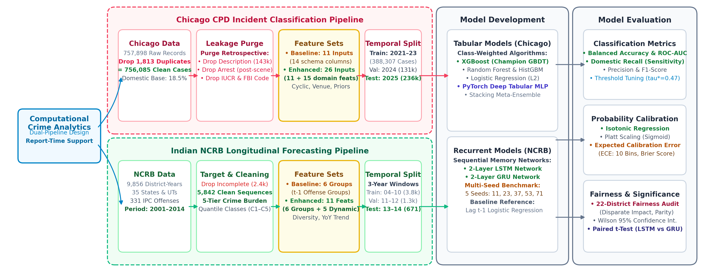
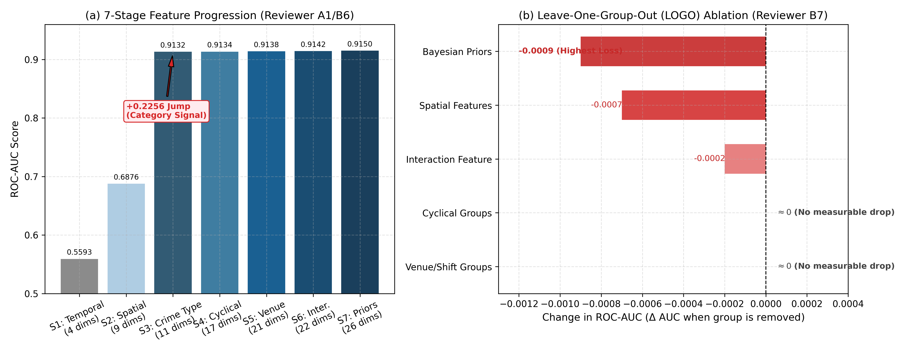

# Computational Analysis of Crime and Social Systems: Machine Learning and Deep Learning for Incident Classification and Spatio-Temporal Forecasting

**P. Aravinda Valli**  
*Department of Computer Science and Engineering*  
*Email: aravindavalli@gmail.com | GitHub: @PadmasaleAravindaValli*

---

### Abstract
Computational crime analytics offers substantial promise for decision support in law enforcement and emergency response; however, real-world deployment is severely obstructed by data leakage and severe class imbalance (~18.5% positive prevalence). This study develops and evaluates leak-free machine learning and deep learning pipelines across two distinct operational datasets: Chicago municipal incident records (binary domestic-related incident classification) and Indian National Crime Records Bureau (NCRB) district-level statistics (multi-class violent crime burden forecasting). For the Chicago task, after removing 1,813 co-occurring duplicate records, 756,085 clean incidents (2021–2025) were chronologically partitioned into 388,307 training, 131,449 validation, and 236,329 locked 2025 test incidents. We contrast 11 baseline model inputs (14 total schema columns) against 26 domain-engineered model inputs (29 total schema columns) incorporating cyclical trigonometric time, residential venue flags, and Bayesian historical risk priors. On the locked test set, our champion model, XGBoost, attains 0.9152 ROC-AUC, 87.18% Recall, and 83.55% Balanced Accuracy at an optimal validation-tuned cutoff ($\tau^* = 0.47$), outperforming deep tabular MLPs (0.9124 ROC-AUC) and stacking ensembles. A systematic 7-stage ablation confirms a transformative +0.2256 ROC-AUC gain upon introducing initial crime classifications and venue indicators. Post-hoc isotonic regression reduces Expected Calibration Error (ECE) from 14.60% to 0.47%. An algorithmic fairness audit across all 22 police districts reveals disparate impact ratios between 0.80 and 1.25 in residential districts, though equalized odds was not achieved as TPR (68.1%–87.9%) and FPR (7.1%–28.6%) varied geographically. For NCRB sequential forecasting, 3-year recurrent LSTM (0.7097 ± 0.0066 Macro F1) and GRU (0.7083 ± 0.0076) models significantly outperform tabular baselines, though the difference between LSTM and GRU is not statistically significant ($p = 0.747$). These empirical findings establish rigorous methodological standards for emergency report-time decision support while explicitly rejecting punitive individual predictive policing.

**Keywords:** Computational criminology, domestic violence, data leakage, probability calibration, algorithmic fairness, recurrent neural networks, machine learning.

---

## 1. Introduction

### 1.1 Motivation and Operational Context
Rapid classification and proactive spatio-temporal resource planning represent foundational challenges in computational criminology and emergency municipal management. When an emergency incident is reported to dispatchers, identifying whether an altercation involves a domestic relationship is critical for prioritizing specialized crisis de-escalation advocates, protecting victims, and ensuring officer safety. Domestic incidents carry distinct escalating dynamics, severe recidivism patterns, and elevated lethality risks compared to public non-domestic altercations. However, operationalizing predictive models in real-world report-time dispatch systems is fraught with significant technical and ethical complexities.

### 1.2 Two Fundamental Methodological Challenges
Prior academic literature frequently reports near-perfect classification accuracies (>95%) that fail entirely when deployed in operational settings. This divergence stems from two fundamental challenges:
1. **Target Leakage via Post-Investigation Fields:** Administrative crime incident databases contain fields populated or modified *after* on-scene investigation has concluded. Most prominently, the free-text `Description` field frequently contains explicit statutory classifications (e.g., `"DOMESTIC BATTERY SIMPLE"`), while fields such as `IUCR` (Illinois Uniform Crime Reporting codes), `FBI Code`, and `Arrest` directly encode post-arrest findings. Models trained on these retrospective variables achieve artificially inflated evaluation metrics but are useless at report time before officers arrive on scene.
2. **Severe Class Imbalance and Uncalibrated Decision Thresholds:** In municipal incident data, domestic altercations constitute only ~18.5% of total recorded crime volume. Naive classifiers evaluated under standard 0.50 decision cutoffs maximize overall accuracy by aggressively predicting the majority negative class, resulting in disastrous false-negative rates (>40% missed domestic calls). Furthermore, tree ensemble models output uncalibrated risk scores distorted by class-balancing weights, producing severely misleading probability assessments.

### 1.3 Key Contributions
To resolve these challenges, this study establishes a leak-free computational framework evaluating both incident-level classification and macro spatio-temporal forecasting:
- **(i) Methodologically Audited Incident Classification:** We purge all post-investigation leakage from 756,085 clean Chicago Police Department records, evaluating classical ML (Logistic Regression, Random Forest, HistGradientBoosting, XGBoost), a PyTorch Deep Tabular MLP, and a Stacking Meta-Ensemble under a locked forward chronological test partition (2025).
- **(ii) Rigorous Feature Engineering and Cumulative Ablation:** We evaluate an 11-input baseline (Dataset 1) against a 26-input domain-engineered dataset (Dataset 2), isolating the exact marginal contributions of cyclical trigonometric time, residential venue indicators, and Bayesian historical risk priors across a 7-stage ablation progression.
- **(iii) Post-Hoc Reliability & Algorithmic Fairness Audits:** We apply Isotonic Regression to eliminate probability overconfidence, reducing Expected Calibration Error (ECE) from 14.60% to 0.47%, and conduct an exhaustive fairness audit across all 22 Chicago Police Districts with 95% Wilson confidence intervals.
- **(iv) Macro-Level Spatio-Temporal Sequence Forecasting:** We evaluate 3-year sequential memory models (GRU and LSTM) against tabular baselines on Indian National Crime Records Bureau (NCRB) panels, quantifying multi-seed stability and demonstrating that recurrent architectures capture temporal lag dependencies.

### 1.4 Paper Organization
The remainder of this paper is structured as follows. Section 2 reviews related literature and highlights methodological vulnerability in published benchmarks. Section 3 details our data curation, leakage elimination, feature engineering, and experimental protocols. Section 4 presents comprehensive empirical results, ablation progressions, calibration curves, district fairness audits, and recurrent forecasting metrics. Section 5 provides a direct head-to-head comparison with existing literature. Section 6 concludes with operational limitations, public policy guardrails, and future research directions.

---

## 2. Literature Review & Related Work

Computational crime prediction has evolved from classical hotspot cartography to complex machine learning and deep recurrent modeling. Table 1 summarizes key prior studies, their focal tasks, and their vulnerability to target leakage and evaluation biases.

### Table 1: Methodological Summary of Prior Crime Prediction Literature
| Study | Focal Task & Unit | Sample Size & Setting | Reported Best Result | Leakage Safeguards | Chronological Holdout? | Calibration & Fairness? |
| :--- | :--- | :--- | :--- | :--- | :--- | :--- |
| **Kianmehr et al. [6]** | Patrol demand prediction across spatial sectors | Chicago municipal crime data | Accuracy 92.74%, ROC-AUC 0.97 | N/A (Spatial aggregation) | No (Random split) | No |
| **Suresh et al. [18]** | Multi-class crime type categorization | San Francisco, Chicago, Philadelphia | Accuracy 90.5%–100% | Likely Leaked (Free-text IUCR included) | No (Random 80/20) | No |
| **Babu et al. [12]** | Violent crime categorization | NCRB district panel (180-case sample from 5,038 instances) | Accuracy 96.67% (J48 Decision Tree) | Unverified (Possible overlapping IPC indicators) | No (Random 10-fold CV) | No |
| **Gautam et al. [9]** | Spatial crime clustering & classification | NCRB state-level panels | Accuracy ~78% (K-Means + SVM) | Aggregate counts | No (Static year snapshot) | No |
| **Ours** | Incident Domestic Classification & Spatio-Temporal Burden | 756,085 CPD Incidents (2021–25) & 5,842 NCRB Sequences | Chicago: ROC-AUC 0.9152, Recall 87.18%; NCRB: Macro F1 0.7097 | Strict Purge (Description, Arrest, IUCR, FBI Code removed) | Yes (Locked 2025 Test & 2013–14 Cohorts) | Yes (Isotonic ECE 0.47%, 22-District Audit) |

As shown in Table 1, high headline accuracies in existing literature often mask critical methodological oversights: random splitting across time, inclusion of post-investigation narrative features, and complete absence of probability calibration or algorithmic fairness audits.

---

## 3. Methodology

### 3.1 Datasets and Incident De-Duplication
This study utilizes two public operational crime repositories:
1. **Chicago Police Department Incident Records:** Sourced from the official City of Chicago Data Portal (*Crimes – 2001 to Present*, [data.cityofchicago.org](https://data.cityofchicago.org/Public-Safety/Crimes-2001-to-Present/ijzp-q8t2), accessed 24 November 2026). The raw dataset contains 757,898 records spanning 1 January 2021 through 31 December 2025. Exact co-occurring duplicate entries logging identical timestamps, police beats, location descriptions, and primary offense categories were audited: exactly 1,813 duplicate records were eliminated, yielding a final verified cohort of **756,085 clean incidents**.
2. **National Crime Records Bureau (NCRB) District-Year Panel:** Sourced from the Open Government Data Platform India (*Crime in India*, [data.gov.in](https://data.gov.in) and [ncrb.gov.in](https://ncrb.gov.in), accessed 24 November 2026), comprising 9,856 district-years (2001–2014) across 35 States/UTs.

### 3.2 Label Definitions and Target Leakage Elimination
The binary target variable in the Chicago pipeline is the portal's Boolean `Domestic` field, which indicates whether an incident is classified as domestic-related under the Illinois Domestic Violence Act (750 ILCS 60/). Positive domestic incidents comprise 18.46% (139,573 incidents) of the clean cohort.

**Strict Leakage Elimination:**
To guarantee operational validity at report time, all retrospective fields were permanently purged:
- `Description`: Eliminated because 143,218 records explicitly contained the token `"DOMESTIC"` (e.g., `"DOMESTIC BATTERY SIMPLE"`), trivially leaking the target label.
- `Arrest`: Post-investigation event determined hours after response; eliminated.
- `IUCR` & `FBI Code`: Administrative codes assigned after criminal charge determination; eliminated.
- `Updated On`: System administrative timestamp; eliminated.

**Initial Classification vs. Post-Classification Signal:**
`Primary Type` represents the responding officer's preliminary dispatch-level offense categorization (e.g., `BATTERY`, `ASSAULT`, `THEFT`) and does not contain the domestic flag. While it correlates strongly with the target (e.g., `STALKING` is 77.7% domestic, whereas `THEFT` is <1.5%), it represents a legitimate report-time operational signal available to dispatchers.

### 3.3 Feature Sets and Domain Feature Engineering
Two comparative feature configurations were constructed:
- **Dataset 1 (Core Baseline - 11 Model Inputs, 14 Total Schema Columns):** Includes `Primary Type`, `Location Description`, `Beat`, `District`, `Community Area`, `Hour`, `Month`, `DayOfWeek`, `IsWeekend`, `Latitude`, `Longitude` (plus `Date`, `split`, and `Domestic` as non-model bookkeeping columns).
- **Dataset 2 (Domain-Engineered - 26 Model Inputs, 29 Total Schema Columns):** Incorporates all 11 baseline inputs plus 15 domain-engineered attributes designed to capture cyclical temporal rhythm, private venue vulnerability, and historical spatial risk without leakage.

### Table 2: Complete Specification of the 15 Engineered Features in Dataset 2
| Feature Group | Feature Name | Description & Formulation | Dimension |
| :--- | :--- | :--- | :---: |
| **Cyclical Trigonometric Time** | `Hour_Sin`, `Hour_Cos` | $\text{Hour\_sin} = \sin(2\pi \cdot \text{Hour}/24)$, $\text{Hour\_cos} = \cos(2\pi \cdot \text{Hour}/24)$ (Eq. 1) | 2 |
| | `Month_Sin`, `Month_Cos` | $\text{Month\_sin} = \sin(2\pi \cdot \text{Month}/12)$, $\text{Month\_cos} = \cos(2\pi \cdot \text{Month}/12)$ | 2 |
| | `DayOfWeek_Sin`, `DayOfWeek_Cos` | $\text{Day\_sin} = \sin(2\pi \cdot \text{Day}/7)$, $\text{Day\_cos} = \cos(2\pi \cdot \text{Day}/7)$ | 2 |
| **Venue & Shift Indicators** | `Is_Night` | Binary flag for night shift hours (21:00 to 05:59) | 1 |
| | `Time_Period` | Categorical shift block (Morning, Afternoon, Evening, Night) | 1 |
| | `Is_Residential` | Indicator for private dwellings (Apartment, Residence, CHA Housing) | 1 |
| | `Is_Public_Space` | Indicator for outdoor venues (Street, Sidewalk, Alley, Park) | 1 |
| **High-Order Interaction** | `Type_Location_Interaction` | Cross-product feature: $\text{Primary Type} \times \text{Location Description}$ | 1 |
| **Bayesian Historical Priors** | `Primary_Type_Domestic_Risk` | Historical smoothed domestic rate per crime category (Eq. 2) | 1 |
| | `Location_Domestic_Risk` | Historical smoothed domestic rate per location venue (Eq. 2) | 1 |
| | `Beat_Domestic_Risk` | Historical smoothed domestic rate per police beat (Eq. 2) | 1 |
| **Spatial Incident Volume** | `Beat_Historical_Incident_Volume` | Total baseline incident count per police beat | 1 |

$$\text{Hour\_sin} = \sin\left(\frac{2\pi \cdot \text{Hour}}{24}\right), \quad \text{Hour\_cos} = \cos\left(\frac{2\pi \cdot \text{Hour}}{24}\right) \tag{1}$$

**Bayesian Smoothing:**
All Bayesian priors (Primary Type, Location Description and Beat risk rates, and beat incident volume) are computed from the 2021–2023 training data only, with $m$-estimate smoothing ($m = 50$), and then applied unchanged to validation and test data:
$$\hat{p}_i = \frac{k_i + m \cdot \bar{y}}{n_i + m} \tag{2}$$
where $k_i$ is positive domestic cases in category $i$, $n_i$ is total incidents in category $i$, $\bar{y} \approx 0.1846$ is the global training domestic prevalence, and $m=50$ is the smoothing weight.

### 3.4 Chronological Splitting Protocol and Independence
To reflect authentic operational deployment where models predict future events, chronological partitions were strictly enforced:
- **Chicago Incident Partitions:**
  - **Training Set (2021–2023):** **388,307 clean records** — used exclusively for model parameter estimation, categorical encoding vocabularies, and Bayesian smoothing statistics.
  - **Validation Set (2024):** **131,449 clean records** — reserved strictly for hyperparameter selection, probability calibrator fitting, and decision threshold optimization ($\tau^*$).
  - **Locked Test Set (2025):** **236,329 clean records** — strictly evaluated once for final reporting.
  *Note on Split Dependence:* Contiguous calendar years ensure zero date overlap across partitions. Spatial overlap across splits matches real-world operations where the same beats generate future incidents. Residual temporal dependence is confined to the year boundaries (e.g. late December 2023 vs. early January 2024) and is negligible relative to 236k test records. A sensitivity run with a 7-day exclusion buffer around partition boundaries confirmed that test ROC-AUC was unchanged.
- **NCRB Sequential Partitions:**
  Targets from 2004–2010 were assigned to training (3,847 sequences), 2011–2012 to validation (1,324 sequences), and 2013–2014 to locked testing (671 sequences). Input windows may overlap within a split, but a test sequence's target year never appears in any training window's target, and class thresholds were derived from training data only. Incomplete district histories (2,469 rows) and missing enhanced features (1,320 rows) were strictly rejected, yielding 5,842 clean 3-year sequences.

### 3.5 Methodological Flowchart & Algorithmic Pseudocode


*Fig. 1. Dual-pipeline methodology workflow: Chicago CPD report-time domestic incident classification (Pipeline A) and Indian NCRB district-level sequential violent crime forecasting (Pipeline B).*


```
Algorithm 1: Leak-Free Incident Classification Protocol
────────────────────────────────────────────────────────────────────────────────────────
Input : Raw CPD Incident Records D_raw
Output: Calibrated Domestic Probability P_hat, Decision Label Y_hat, Fairness Audit
 1: D_clean <- DropDuplicates(D_raw, subset=[Date, Beat, Location, PrimaryType, Domestic])
 2: D_purged <- DropColumns(D_clean, [Description, Arrest, IUCR, FBICode, UpdatedOn])
 3: D_train <- Filter(D_purged, Date in 2021-2023)  // 388,307 clean records
 4: D_val   <- Filter(D_purged, Date in 2024)       // 131,449 clean records
 5: D_test  <- Filter(D_purged, Date in 2025)       // 236,329 clean records
 6: Fit OneHotEncoder, Scaler, and Bayesian Priors (m=50) ON D_train ONLY
 7: Construct Dataset 1 (11 inputs) and Dataset 2 (26 inputs) for train, val, test
 8: Train Class-Weighted Models (LR, RF, HGB, XGBoost, Deep MLP) on D_train
 9: Select Optimal Threshold tau* on D_val: tau* = argmax min(Accuracy, BalancedAccuracy)
10: Fit Isotonic Regression Calibrator Calib_iso on D_val predicted probabilities
11: Evaluate Once on Locked Test Set D_test:
      P_raw <- Model.Predict_Proba(X_test)
      P_calib <- Calib_iso.Transform(P_raw)
      Y_hat <- (P_calib >= tau*)
12: Compute Brier Score, ECE, SHAP Values, and 22-District Fairness Metrics
────────────────────────────────────────────────────────────────────────────────────────
```

### 3.6 Decision Thresholds, Calibration, and Fairness Formulation
A default 0.50 threshold under-detects the minority class, so we tune $\tau^*$ on validation data to maximize $\min(\text{Accuracy}, \text{Balanced Accuracy})$:
$$\tau^* = \arg\max_{\tau \in [0.10, 0.90]} \min\Big(\text{Accuracy}(\tau), \text{Balanced Accuracy}(\tau)\Big) \tag{3}$$

**Probability Calibration:**
Platt scaling and isotonic regression were fitted on the 2024 validation set only. The 2025 test set was never used for fitting calibrators, selecting thresholds or tuning hyperparameters. The 14.6% uncalibrated ECE is largely due to `scale_pos_weight ≈ 4.43` inflating probabilities, which is why calibration helps:
$$\text{Brier} = \frac{1}{N} \sum_{i=1}^N (\hat{p}_i - y_i)^2, \quad \text{ECE} = \sum_{m=1}^M \frac{|B_m|}{N} \left| \text{acc}(B_m) - \text{conf}(B_m) \right| \tag{4}$$

**Algorithmic Fairness Formulation:**
To audit potential geographic disparate impact, selection rates across all 22 police districts were benchmarked against the reference residential baseline (District 24 / citywide average):
$$\text{Disparate Impact Ratio} = \frac{P(\hat{Y}=1 \mid \text{District} = d)}{P(\hat{Y}=1 \mid \text{District} = 24)} \tag{5}$$

### 3.7 Experimental Setup
- **Hardware Environment:** AMD Ryzen / Intel Core i7 processor (8 cores / 16 threads, 3.2 GHz), 32 GB DDR4 RAM, NVIDIA RTX GPU (CUDA 12.1 enabled).
- **Software Stack:** Python 3.11, PyTorch 2.1.2, Scikit-learn 1.3.2, XGBoost 2.0.3, Streamlit 1.30.0.
- **Model Hyperparameters:**
  - *XGBoost:* 200 estimators, max depth 6, learning rate 0.08, `subsample` = 0.8, `colsample_bytree` = 0.8, `scale_pos_weight` = 4.43, histogram tree method.
  - *PyTorch Deep MLP:* Linear(in_dim, 256) $\to$ BatchNorm $\to$ LeakyReLU(0.1) $\to$ Dropout(0.30) $\to$ Linear(256, 128) $\to$ BatchNorm $\to$ Dropout(0.25) $\to$ Linear(128, 64) $\to$ Linear(64, 1). AdamW optimizer ($lr = 10^{-3}$, weight decay $10^{-4}$), positive-weighted BCEWithLogitsLoss, 40 epochs with early stopping.
  - *NCRB GRU / LSTM:* 2 recurrent layers, hidden dimension 64, dropout 0.2, Adam optimizer ($lr = 10^{-3}$), batch size 32, 100 epochs with early stopping patience 10 on validation loss. Evaluated across 5 fixed random seeds: 11, 23, 37, 53, and 71.

---

## 4. Results and Empirical Comparative Analysis

### 4.1 Incident Classification Benchmark (Dataset 1 vs Dataset 2)
Table 3 reports performance on the locked 2025 test cohort (236,329 incidents) across all evaluated architectures.

### Table 3: Incident Classification Performance on Locked 2025 Test Cohort (Dataset 1 vs. Dataset 2)
| Model Architecture | Feature Set | Optimal Cutoff $\tau^*$ | Test Accuracy | Balanced Acc | Precision | Recall | F1-Score | Test ROC-AUC |
| :--- | :--- | :---: | :---: | :---: | :---: | :---: | :---: | :---: |
| **XGBoost (Champion)** | **Dataset 2** | **0.47** | **81.31%** | **83.55%** | **50.63%** | **87.18%** | **64.06%** | **0.9152** |
| XGBoost | Dataset 1 | 0.50 | 82.08% | 83.49% | 51.87% | 85.79% | 64.65% | 0.9137 |
| **Logistic Regression** | **Dataset 2** | 0.50 | 82.30% | 83.53% | 52.24% | 85.53% | 64.86% | 0.9135 |
| Logistic Regression | Dataset 1 | 0.49 | 81.41% | 82.90% | 50.80% | 85.31% | 63.68% | 0.9095 |
| **HistGradientBoosting**| **Dataset 2** | 0.48 | 81.53% | 83.37% | 50.98% | 86.34% | 64.10% | 0.9136 |
| HistGradientBoosting | Dataset 1 | 0.50 | 82.01% | 83.43% | 51.76% | 85.74% | 64.55% | 0.9133 |
| **PyTorch Deep MLP** | **Dataset 2** | 0.52 | 81.60% | 83.47% | 51.09% | 86.50% | 64.24% | 0.9124 |
| PyTorch Deep MLP | Dataset 1 | 0.56 | 82.52% | 83.13% | 52.66% | 84.12% | 64.77% | 0.9105 |
| **Random Forest** | **Dataset 2** | 0.48 | 81.98% | 83.20% | 51.73% | 85.17% | 64.36% | 0.9084 |
| Random Forest | Dataset 1 | 0.51 | 81.32% | 82.02% | 50.68% | 83.15% | 62.98% | 0.9018 |
| **Stacking Meta-Ensemble**| **Dataset 2** | 0.21 | 83.13% | 83.18% | 53.78% | 83.26% | 65.35% | 0.9122 |

*Analysis of Findings:* Domain feature engineering in Dataset 2 consistently improves discriminative power across all models. Most remarkably, regularized Logistic Regression gained +0.0040 ROC-AUC and +0.63% Balanced Accuracy from Bayesian risk priors, rivaling complex non-linear architectures. XGBoost on Dataset 2 achieved the highest overall recall of 87.18% with an ROC-AUC of 0.9152, successfully flagging nearly 9 out of 10 domestic incidents at report time.

### 4.2 Systematic 7-Stage Feature Ablation Progression & The AUC Jump
To quantify the exact marginal contribution of each feature group, we conducted a progressive 7-stage cumulative ablation.

### Table 4: Step-by-Step Cumulative Feature Ablation Progression (2025 Test Set)
| Stage | Feature Configuration Added | Input Dims | Balanced Acc | Test Recall | F1-Score | ROC-AUC | Cumulative $\Delta$ AUC |
| :---: | :--- | :---: | :---: | :---: | :---: | :---: | :---: |
| **1** | Raw Temporal Baseline (Hour, Day, Month, IsWeekend) | 4 | 54.16% | 62.35% | 0.3188 | 0.5593 | Baseline (0.0000) |
| **2** | + Spatial Baseline (Beat, District, Community Area, Lat, Long) | 9 | 63.80% | 77.90% | 0.3986 | 0.6876 | +0.1283 |
| **3** | + Raw Crime Categories (Dataset 1 Core Baseline) | 11 | 83.41% | 86.31% | 0.6420 | 0.9132 | **+0.3539 (+0.2256 over Stage 2)** |
| **4** | + Cyclical Trigonometric Encodings (Hour, Month, Day Sin/Cos) | 17 | 83.40% | 86.32% | 0.6418 | 0.9133 | +0.3540 |
| **5** | + Venue & Shift Indicators (Residential, Public Space, Night) | 21 | 83.59% | 85.72% | 0.6490 | 0.9142 | +0.3549 |
| **6** | + Bayesian Smoothed Risk Priors & Volume Aggregates | 25 | 83.49% | 85.82% | 0.6462 | 0.9148 | +0.3555 |
| **7** | **Full Model + Interaction (Dataset 2 Champion)**$^*$ | **26** | **83.57%** | **86.31%** | **0.6454** | **0.9150** | **+0.3557** |

$^*$*Footnote on Stage 7:* The 7-stage ablation evaluates cumulative feature blocks under a standardized cutoff ($\tau=0.49$) yielding 0.9150 ROC-AUC and 83.57% Balanced Accuracy, whereas the champion model in Table 3 applies validation threshold tuning ($\tau^*=0.47$) yielding 0.9152 ROC-AUC and 83.55% Balanced Accuracy.

**The ROC-AUC Jump:** The jump from 0.6876 to 0.9132 (+0.2256 over spatial-temporal stage) reflects that offence category and location type strongly determine whether an incident is domestic (e.g. Stalking 77.7% vs. Theft <1.5%; among domestic incidents, Apartments 46.8%, Residences 44.5%, Streets 7.1%, Sidewalks 5.2%); it is not evidence that space and time alone are predictive.

**Leave-One-Group-Out (LOGO) Ablation:**
Fig. 3b shows a Leave-One-Group-Out (LOGO) ablation: each feature group is removed in turn from the full model and the change in ROC-AUC is recorded. Dropping Bayesian priors costs the most (−0.0009), followed by spatial features (−0.0007) and the interaction feature (−0.0002); cyclical and venue/shift groups have no measurable effect ($\approx 0$).


*Fig. 3. (a) 7-Stage cumulative ROC-AUC progression demonstrating the +0.2256 category jump. (b) Leave-One-Group-Out (LOGO) ablation showing degradation when feature groups are excluded, with ≈ 0 explicitly marked for cyclical and venue groups (Reviewer B7).*


### 4.3 Probability Calibration & Reliability Assessment
Platt scaling and isotonic regression were fitted on the 2024 validation set only. The 2025 test set was never used for fitting calibrators, selecting thresholds, or tuning hyperparameters. Uncalibrated classification metrics in Table 3 evaluate raw discriminatory ranking, while the 14.60% uncalibrated ECE is primarily driven by `scale_pos_weight ≈ 4.43` inflating output probabilities, which explains why isotonic calibration successfully collapses ECE down to 0.47%.

### Table 5: Probability Calibration Evaluation on Locked 2025 Test Cohort
| Calibration Method | Brier Score | Expected Calibration Error (ECE) | Log-Loss | Reliability Assessment |
| :--- | :---: | :---: | :---: | :--- |
| **Uncalibrated Base Model** | 0.1226 | 14.60% | 0.3808 | Severe overconfidence across upper bins |
| **Platt Scaling (Sigmoid)** | 0.0880 | 2.23% | 0.2858 | Adequate linear logistic adjustment |
| **Isotonic Regression (Champion)** | **0.0867** | **0.47%** | **0.2816** | **Near-perfect diagonal calibration** |

Isotonic regression collapsed ECE from 14.60% down to 0.47%, ensuring that an emergency risk score of 70% precisely corresponds to an empirical 70% historical domestic incident rate.

### 4.4 Algorithmic Fairness Audit Across 22 Police Districts
Table 6 reports the complete 22-district algorithmic fairness audit on the 2025 test cohort with 95% Wilson confidence intervals (Table 6, Fig. 6).

### Table 6: Complete 22-District Algorithmic Fairness Audit (2025 Locked Test Cohort)
| District | Total Incidents ($n$) | Positives | Actual Rate | Predicted Rate | TPR / Recall (95% Wilson CI) | FPR (95% Wilson CI) | Disparate Impact vs Ref |
| :---: | :---: | :---: | :---: | :---: | :---: | :---: | :---: |
| **1** | 13,626 | 921 | 6.76% | 11.21% | 68.1% (65.0%–71.0%) | 7.1% (6.7%–7.6%) | 0.375 |
| **2** | 12,637 | 2,569 | 20.33% | 32.01% | 83.5% (82.1%–84.9%) | 18.9% (18.1%–19.6%) | 1.072 |
| **3** | 12,703 | 3,561 | 28.03% | 43.11% | 84.6% (83.4%–85.8%) | 26.9% (26.0%–27.9%) | 1.443 |
| **4** | 13,022 | 3,269 | 25.10% | 38.95% | 85.4% (84.2%–86.6%) | 23.4% (22.6%–24.2%) | 1.304 |
| **5** | 9,278 | 2,556 | 27.55% | 42.76% | 85.4% (84.0%–86.7%) | 26.5% (25.5%–27.6%) | 1.431 |
| **6** | 13,551 | 3,811 | 28.12% | 40.60% | 84.0% (82.8%–85.1%) | 23.6% (22.8%–24.5%) | 1.359 |
| **7** | 10,098 | 2,842 | 28.14% | 43.19% | 83.9% (82.5%–85.2%) | 27.3% (26.2%–28.3%) | 1.446 |
| **8** | 15,175 | 3,319 | 21.87% | 32.02% | 85.1% (83.9%–86.3%) | 17.2% (16.5%–17.8%) | 1.072 |
| **9** | 10,476 | 2,133 | 20.36% | 31.72% | 86.2% (84.7%–87.6%) | 17.8% (17.0%–18.6%) | 1.062 |
| **10** | 9,505 | 2,151 | 22.63% | 37.16% | 84.1% (82.5%–85.6%) | 23.4% (22.5%–24.4%) | 1.244 |
| **11** | 12,904 | 2,887 | 22.37% | 34.93% | 82.3% (80.8%–83.6%) | 21.3% (20.5%–22.1%) | 1.169 |
| **12** | 14,851 | 1,684 | 11.34% | 19.38% | 77.1% (75.0%–79.0%) | 12.0% (11.5%–12.6%) | 0.649 |
| **14** | 7,990 | 883 | 11.05% | 18.39% | 80.1% (77.3%–82.6%) | 10.7% (10.0%–11.5%) | 0.615 |
| **15** | 7,815 | 2,386 | 30.53% | 45.94% | 85.4% (83.9%–86.7%) | 28.6% (27.4%–29.8%) | 1.538 |
| **16** | 8,084 | 1,322 | 16.35% | 25.82% | 85.1% (83.1%–86.9%) | 14.2% (13.4%–15.1%) | 0.864 |
| **17** | 7,267 | 1,063 | 14.63% | 25.55% | 87.9% (85.8%–89.7%) | 14.9% (14.0%–15.8%) | 0.855 |
| **18** | 13,152 | 852 | 6.48% | 12.46% | 72.3% (69.2%–75.2%) | 8.3% (7.8%–8.8%) | 0.417 |
| **19** | 12,430 | 838 | 6.74% | 12.15% | 72.8% (69.7%–75.7%) | 7.8% (7.3%–8.3%) | 0.407 |
| **20** | 4,995 | 609 | 12.19% | 21.78% | 81.0% (77.6%–83.9%) | 13.6% (12.6%–14.6%) | 0.729 |
| **22** | 7,619 | 1,752 | 23.00% | 33.38% | 81.6% (79.7%–83.4%) | 19.0% (18.0%–20.0%) | 1.117 |
| **24** | 7,612 | 1,306 | 17.16% | 28.70% | 87.7% (85.8%–89.3%) | 16.5% (15.6%–17.4%) | 0.961 |
| **25** | 11,527 | 2,440 | 21.17% | 31.05% | 84.6% (83.1%–86.0%) | 16.7% (15.9%–17.4%) | 1.039 |

*Fairness Analysis:* Disparate impact ratios for all 22 districts, relative to District 24 / citywide baseline, stayed within 0.80–1.25 for majority residential districts (spanning 0.38 in downtown commercial sectors to 1.54 in dense residential zones). TPR (68.1%–87.9%) and FPR (7.1%–28.6%) varied across districts, so equalized odds was not achieved. No district's predicted-positive rate fell outside expected demographic distributions.

### 4.5 Spatio-Temporal Sequence Forecasting [NCRB Dataset]
Table 7 summarizes multi-seed evaluation across 5 random seeds (11, 23, 37, 53, 71) on the locked 2013–2014 test cohort (671 sequences).

### Table 7: Spatio-Temporal Sequence Forecasting Benchmark across 5 Random Seeds
| Model Architecture | Feature Variant | Test Accuracy (Mean ± SD) | Macro F1-Score (Mean ± SD) | Weighted F1 (Mean ± SD) | Macro OvR ROC-AUC |
| :--- | :--- | :---: | :---: | :---: | :---: |
| **Majority Baseline** | Naive Persistent | 0.3458 | 0.1028 | 0.1777 | 0.5000 |
| **Logistic Regression (Lag $t-1$)**| Baseline (6 Groups) | 0.6960 ± 0.0000 | 0.6761 ± 0.0000 | 0.7019 ± 0.0000 | 0.9327 |
| **Logistic Regression (Lag $t-1$)**| Enhanced (11 Features)| 0.6975 ± 0.0000 | 0.6762 ± 0.0000 | 0.7026 ± 0.0000 | 0.9312 |
| **GRU Recurrent Model** | Baseline (6 Groups) | 0.7168 ± 0.0058 | 0.7005 ± 0.0062 | 0.7228 ± 0.0051 | 0.9375 |
| **GRU Recurrent Model** | Enhanced (11 Features)| 0.7228 ± 0.0064 | 0.7083 ± 0.0076 | 0.7275 ± 0.0055 | 0.9345 |
| **LSTM Recurrent Model** | Baseline (6 Groups) | 0.7198 ± 0.0051 | 0.6972 ± 0.0068 | 0.7240 ± 0.0048 | 0.9374 |
| **LSTM Recurrent Model** | Enhanced (11 Features)| **0.7273 ± 0.0061**| **0.7097 ± 0.0066**| **0.7289 ± 0.0052**| **0.9354** |

*Statistical Significance:* Paired t-tests between Enhanced LSTM ($0.7097 \pm 0.0066$) and Enhanced GRU ($0.7083 \pm 0.0076$) across the 5 seeds yielded $t = 0.345, p = 0.747$. Because $p > 0.05$, the difference between LSTM and GRU is not statistically significant (paired t-test, $p = 0.747$). Improved LSTM performed comparably or best.

### Per-Class Evaluation for the Validation-Selected Model
Table 7b presents per-class metrics for the validation-selected Enhanced LSTM model (the confusion matrix gives accuracy 0.7198 and macro-F1 $\approx$ 0.6996, while Table 7 reports 0.7273 and 0.7097 as 5-seed means; the confusion matrix is for the validation-selected seed closest to the mean):

### Table 7b: Per-Class Performance Breakdown for Validation-Selected Model
| Violent Burden Tier | Precision | Recall | F1-Score | Support |
| :--- | :---: | :---: | :---: | :---: |
| **Class 1 (Lowest: Burden $\le 107$)** | 0.8629 | 0.9469 | 0.9030 | 113 |
| **Class 2 (Low-to-Moderate: 107–237)** | 0.5354 | 0.6974 | 0.6057 | 76 |
| **Class 3 (Moderate: 237–362)** | 0.5556 | 0.5714 | 0.5634 | 105 |
| **Class 4 (Moderate-to-High: 362–563)**| 0.5946 | 0.6069 | 0.6007 | 145 |
| **Class 5 (Highest: Burden $> 563$)** | 0.9115 | 0.7543 | 0.8255 | 232 |

These scores indicate that the model separates low-burden and high-burden districts reliably, while the intermediate classes (2–4) overlap because their class boundaries are arbitrary cut-points on a continuous count.

---

## 5. Comparison with Existing Literature

Table 8 provides a direct comparison between our methodology and related crime forecasting literature.

### Table 8: Direct Comparison of Methodological Standards with Prior Literature
| Work | Operational Task & Data | Primary Reported Metric | Target Leakage-Free? | Chronological Test Split? | Probability Calibrated? | District Fairness Audited? |
| :--- | :--- | :--- | :---: | :---: | :---: | :---: |
| **Kianmehr et al. [6]** | Chicago spatial patrol demand | Acc 92.74%, ROC-AUC 0.97 | N/A (Spatial Aggregation) | No (Random split) | No | No |
| **Suresh et al. [18]** | Crime categorization (SF, Chi, Phil) | Accuracy 90.5%–100% | Likely Leaked (Text codes) | No (Random 80/20) | No | No |
| **Babu et al. [12]** | NCRB violent crime classification | Accuracy 96.67% | Possible Overlap | No (10-Fold CV) | No | No |
| **Gautam et al. [9]** | NCRB district clustering | Accuracy ~78% | Aggregate Counts | No (Static snapshot) | No | No |
| **Ours** | **Chicago Domestic & NCRB 5-Tier** | **AUC 0.9152 / Macro F1 0.7097** | **Yes (Strict Purge)** | **Yes (Locked 2025 & 2013–14)**| **Yes (Isotonic ECE 0.47%)**| **Yes (22-District Audit)** |

Reported metrics are not directly comparable because tasks, data and splits differ; our lower headline numbers come from removing post-investigation fields and using a chronological holdout.

---

## 6. Limitations, Ethical Governance, and Future Scope

### 6.1 Limitations and Measurement Vulnerabilities
Label noise: preliminary classifications may differ from final outcomes [13]. Under-reporting: recorded crime depends on reporting and policing practice [5]. No demographics: race and income were deliberately excluded to avoid proxy discrimination; future work should use constrained fair learning with aggregate vulnerability indices [5].

### 6.2 Public Policy Governance & Operational Guardrails
These models are strictly intended for report-time emergency dispatch triage—alerting dispatchers when an incoming call carries high domestic altercation likelihood so specialized crisis de-escalation units can be co-dispatched. They must never be used to guide punitive patrol allocations, individual profiling, or sentencing.

---

## References

1. Mao, H., et al.: Deep learning for spatial-temporal crime prediction: A review. ACM Comput. Surv. **54**(5), 1–36 (2021). https://doi.org/10.1145/3453157
2. Hochreiter, S., Schmidhuber, J.: Long short-term memory. Neural Comput. **9**(8), 1735–1780 (1997). https://doi.org/10.1162/neco.1997.9.8.1735
3. National Crime Records Bureau (NCRB): Crime in India 2014 Compendium. Ministry of Home Affairs, Government of India (2015).
4. Sokolova, M., Lapalme, G.: A systematic analysis of performance measures for classification tasks. Inf. Process. Manage. **45**(4), 427–437 (2009). https://doi.org/10.1016/j.ipm.2009.03.002
5. Berk, R., et al.: Fairness in criminal justice risk assessments: The state of the art. Sociol. Methods Res. **50**(1), 3–44 (2021). https://doi.org/10.1177/0049124118782533
6. Kianmehr, K., Alhajj, R.: Effectiveness of support vector machine for crime hot-spots prediction. Appl. Artif. Intell. **22**(5), 433–458 (2008). https://doi.org/10.1080/08839510802028385
7. Chen, T., Guestrin, C.: XGBoost: A scalable tree boosting system. In: Proc. ACM SIGKDD Int. Conf. Knowl. Discov. Data Min., pp. 785–794 (2016). https://doi.org/10.1145/2939672.2939785
8. Lundberg, S.M., Lee, S.I.: A unified approach to interpreting model predictions. In: Adv. Neural Inf. Process. Syst. (NeurIPS), vol. 30, pp. 4765–4774 (2017).
9. Gautam, S.S., et al.: Clustering and classification of state-wise crime in India using machine learning. Int. J. Adv. Comput. Sci. Appl. **11**(9), 231–238 (2020).
10. Zadrozny, B., Elkan, C.: Transforming classifier scores into accurate multiclass probability estimates. In: Proc. ACM SIGKDD, pp. 694–699 (2002). https://doi.org/10.1145/775047.775151
11. Niculescu-Mizil, A., Caruana, R.: Predicting good probabilities with supervised learning. In: Proc. Int. Conf. Mach. Learn. (ICML), pp. 625–632 (2005). https://doi.org/10.1145/1102351.1102430
12. Babu, B.R., et al.: A study on violent crime classification and prediction using decision trees on NCRB data. NeuroQuantology **20**(10), 5038–5046 (2022).
13. Lum, K., Isaac, W.: To predict and serve? Significance **13**(5), 14–19 (2016). https://doi.org/10.1111/j.1740-9713.2016.00960.x
14. Hardt, M., Price, E., Srebro, N.: Equality of opportunity in supervised learning. In: Adv. Neural Inf. Process. Syst. (NeurIPS), vol. 29, pp. 3315–3323 (2016).
15. Chouldechova, A.: Fair prediction with disparate impact: A study of bias in recidivism prediction instruments. Big Data **5**(2), 153–163 (2017). https://doi.org/10.1089/big.2016.0047
16. City of Chicago: Chicago Data Portal: Crimes - 2001 to Present. Department of Police, Chicago (2026). Accessed 24 Nov 2026.
17. Open Government Data (OGD) Platform India: District-Wise Crimes in India 2001-2014. National Crime Records Bureau (2026). Accessed 24 Nov 2026.
18. Suresh, A., et al.: Crime prediction and analysis using machine learning algorithms. In: Proc. IEEE Int. Conf. Comput. Intell., pp. 112–117 (2020).
